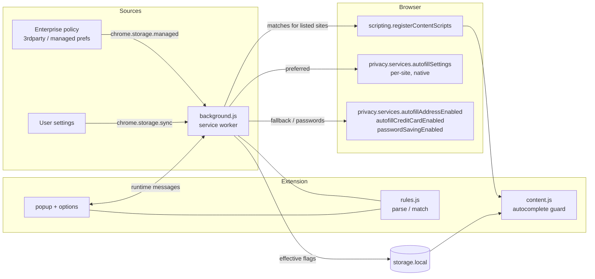
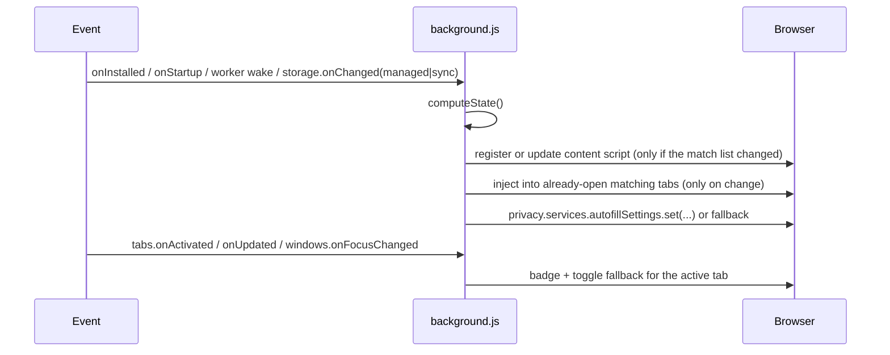

# Architecture

Autofill Guard is a Manifest V3 extension for Chromium-based browsers (Chrome, Edge, Vivaldi). On sites an administrator or user lists, it stops the browser from **saving or suggesting** form data. This document covers how it is built and why. For installation and deployment, see the [README](../README.md).

## Goals and non-goals

**Goals**
- Block single-field autocomplete (previously typed values) per site. No native policy covers this.
- Block Autofill profile data (addresses, contact info, cards) per site, and optionally the password manager.
- Let administrators manage sites centrally with *mandatory* and *recommended* entries, while users can optionally add their own.
- Never touch pages that aren't listed.

**Non-goals**
- Deleting data that is already saved. The extension prevents new saves and suggestions; it does not purge history.
- Blocking third-party password managers or form-filler extensions. It adds only advisory hints for those.
- Firefox. Its autofill model and extension APIs are different.

## Components

| File | Role |
|---|---|
| `extension/src/rules.js` | Pure functions to parse site entries, match URLs, and convert entries to extension match patterns and content-settings patterns. Shared by every context. |
| `extension/src/background.js` | Merges configuration, registers the content script, applies the autofill and password mechanisms, tracks the active tab, sets the badge, and answers the UI. |
| `extension/src/content.js` | Runs only on listed sites and forces `autocomplete="off"` on forms and fields. |
| `extension/src/popup.*`, `options.*` | Popup and options page. Both are thin clients of the background message API. |
| `extension/schema.json` | Managed-storage schema. It is the single source for policy names, titles and descriptions, which the ADMX/ADML templates reuse. |
| `tools/gen_policy_templates.py` | Generates the ADMX/ADML, .reg, Linux JSON and macOS profiles from the schema and the extension ID. |
| `scripts/build.mjs` | Produces the store zip, the unpacked zip, the signed CRX, `updates.xml` and checksums. |

## Configuration model

There are three inputs:

1. **Policy** (`chrome.storage.managed`): `MandatorySites`, `RecommendedSites`, `AllowUserSites`, `AllowDisablingRecommended`, and the four `Block*`/`ShowBadge` booleans.
2. **User settings** (`chrome.storage.sync`): `userSites`, `disabledRecommended` (a list of rule keys), and `prefs`.
3. **Defaults**: autocomplete and autofill are blocked; passwords are not; the badge is shown.

Merge rules (`computeState()`):

- **Booleans**: a policy value wins *and locks* the setting. Otherwise the user's value applies, then the default. Chromium's extension policy has no "recommended" level, so the extension defines its own mandatory/recommended split for sites. Any boolean set by policy is mandatory.
- **Sites**: the effective list is mandatory ∪ (recommended − disabled) ∪ user sites, the last only if `AllowUserSites` is true. Entries are normalised to a canonical key (for example `*://example.com` or `https://=login.example.com`) and de-duplicated with precedence mandatory > recommended > user. A shadowed duplicate is shown in the UI but never counted twice.
- Invalid entries are dropped and reported in the options page, so a typo in policy can't break the list.

### Site entry grammar
`[http|https://][=|*.|.]host[:port][/path]`. A bare host matches that host and all its subdomains. A leading `=` means that exact host only. IP addresses, IPv6 literals and single-label hosts always match exactly. Ports and paths are stripped: match patterns can't express ports, and autofill decisions are effectively per origin anyway.

Each rule is converted twice:

| Rule | Content-script match pattern | Native content-settings pattern |
|---|---|---|
| `example.com` | `*://*.example.com/*` | `[*.]example.com` |
| `=login.example.com` | `*://login.example.com/*` | `login.example.com` |
| `https://example.com` | `https://*.example.com/*` | `https://[*.]example.com` |

## Blocking mechanisms

### 1. Single-field autocomplete: content script
Chromium ignores `autocomplete="off"` for Autofill profile data and passwords, but **honours it for single-field autocomplete**: values are neither suggested nor saved. The e2e canary test checks this against the real browser on every run. Unrecognised tokens such as `autocomplete="nope"` do *not* stop saving, so the extension always uses `off`.

`content.js` is registered with `scripting.registerContentScripts` (`runAt: document_start`, `allFrames`, `matchOriginAsFallback`, `persistAcrossSessions`), only for listed sites. It:

- Processes the existing DOM, then watches it with a `MutationObserver` for added nodes and for changes to the `autocomplete` and `type` attributes. If a page script resets the attribute, the guard puts it back.
- Descends into open shadow roots, and into closed ones via `chrome.dom.openOrClosedShadowRoot`.
- Re-asserts the attribute in capture-phase `pointerdown`, `mousedown`, `focusin`, `keydown`, `submit` and `formdata` listeners. Those fire before Chromium decides whether to suggest or save.
- Caps rewrites per element at 25 outside of events, so a page that keeps fighting the attribute can't trigger an endless mutation loop. The event-time re-assertion still applies.
- Leaves credential fields (`username`, `current-password` and so on) alone unless password blocking is on, so the built-in password manager keeps working on blocked sites by default.
- Stores the page's original value in `data-afg-orig-autocomplete` for debugging. Changes are not reverted live; removing a site takes effect on the next page load.

### 2. Addresses, contact info, cards: native per-site setting, with fallback
- **Preferred:** `chrome.privacy.services.autofillSettings`. It is the extension-API counterpart of the `AutofillSettings` enterprise policy: a list of `{urlPattern, blockedTypes}`. The extension sets `blockedTypes: ['all']` for every effective site. It is not yet documented, but it exists in Chrome 153 and later and is exercised by the e2e tests.
- **Fallback:** when that API is missing or not controllable (for example, an admin set the `AutofillSettings` policy, which takes precedence), the extension switches `autofillAddressEnabled` and `autofillCreditCardEnabled` to `false` while a listed site is the active tab in the focused window, and calls `clear()` when it isn't. Calling `clear()` hands control back to the user's own setting, so the extension never has to store or restore it. The trade-off is that these switches are global for the profile while a listed site is in front.

### 3. Password manager (optional)
`passwordSavingEnabled` is toggled the same way as the fallback above. Password fields also get `autocomplete="new-password"`, which stops Chromium filling saved credentials, plus ignore hints for 1Password, LastPass and Bitwarden. On Edge, the native `PasswordManagerBlocklist` policy is the stronger tool.

## Lifecycle and events

- **Worker restarts.** MV3 service workers stop after about 30 seconds idle and restart on the next event. Each restart runs `refresh()`. Content-script registration is **diff-based**: if the persisted registration already has the same match list, it is left alone. Earlier versions unregistered and re-registered on every wake, which left a gap where navigations went unguarded.
- **Serialisation.** `apply()` runs are chained on one promise, so a burst of storage changes can't interleave registrations.
- **Disable or uninstall.** Chromium automatically removes extension-controlled privacy settings and the native per-site rules, and unregisters dynamic content scripts. Nothing is left behind.

## Message API (popup/options → background)

| Message | Effect |
|---|---|
| `getState {url?}` | Returns the merged state, the mechanism status, and which rule (if any) matches `url`. |
| `addUserSite {entry}` | Validates and appends to `userSites`. Refused if `AllowUserSites` is false. |
| `removeUserSite {key}` | Removes by canonical key. |
| `setRecommendedEnabled {key, enabled}` | Edits `disabledRecommended`. Refused if `AllowDisablingRecommended` is false. |
| `setPref {name, value}` | Refused if that setting is locked by policy. |

The background enforces every lock. The UI also disables locked controls, but that is only presentation.

## Permissions and privacy

| Permission | Why |
|---|---|
| `host_permissions: <all_urls>` | Sites are configured at runtime, so the extension can't declare them in advance. The permission is needed to register the content script on arbitrary listed hosts and to read tab URLs for the badge. The script itself only runs on listed sites. |
| `scripting` | Dynamic content-script registration and injection into already-open tabs. |
| `privacy` | Native per-site autofill setting and the fallback toggles. |
| `tabs` | Reading the active tab's URL for the badge and the fallback toggles. |
| `storage` | Managed, sync and local storage. |

The extension makes no network requests, collects nothing, and never reads field values; it only edits attributes.

## Identity, build and release

- **Stable ID.** `manifest.json` carries the public half of an RSA key in `key`, so unpacked loads and self-signed CRXs always get the ID `pfojbgpchchehdkfmjeblbbilmnaljoj`. The policy templates are generated from that key. The private key lives only in the `CRX_PRIVATE_KEY` repository secret. `npm run keygen` rotates the key, which changes the ID and regenerates the templates.
- **Artifacts** (`scripts/build.mjs`):
  - the unpacked zip
  - the store zip (with `key` removed, since stores assign their own ID)
  - the signed CRX3 (via `crx3`)
  - `updates.xml`, whose codebase is `$CRX_BASE_URL/autofill-guard-<v>.crx`
  - `SHA256SUMS`

  Zips use a fixed mtime so the builds are reproducible. The build fails if the signing key doesn't match the manifest's `key`, or if a tag doesn't match the manifest version.
- **CI** (`.github/workflows/ci.yml`): lint, unit tests, a check that the committed templates match the generator, the e2e suite in Playwright's Chromium with the fixture policy installed, and an unsigned build artifact.
- **Release** (`.github/workflows/release.yml`): pushing a `vX.Y.Z` tag reruns CI, builds signed artifacts and creates a GitHub release.
- **Dependencies:** Renovate. Playwright updates are never automerged, because they change the Chromium version the canary test runs against.

## Testing strategy

| Layer | What it covers |
|---|---|
| Unit (`tests/unit`) | The rule grammar, matching (including look-alike domains), and pattern conversion. |
| E2E (`tests/e2e`) | A real Chromium with a real managed policy: merging, locks, native-setting values, attributes on dynamic, shadow-DOM and hostile pages, user and recommended site flows, and the password toggle. |
| Ground truth | Forms are submitted, then Chromium's `Web Data` SQLite database is read to prove that a value from a blocked site was **not saved** and a control value was. |
| Canary | Runs without the extension and checks that Chromium still honours `autocomplete="off"`, so a browser-side change shows up in CI and isn't discovered later in production. |

## Known limitations

- A cross-origin iframe inside a listed site is guarded only if its own origin is listed.
- In fallback mode, address and card autofill is globally off while a listed site is the active tab.
- Saving that happens before the first registration after a fresh install (about 3 seconds) is not guarded.
- Pages that send form data via scripts without a form submission bypass Chromium's save logic entirely, so there is nothing to block.
- The extension isn't enabled in Incognito/InPrivate unless the user allows it; no policy can force that.
- Vivaldi: tested on macOS, where it reads policy from `com.vivaldi.Vivaldi.extensions.<id>` and exposes the native per-site autofill setting. Its Windows and Linux policy locations are untested (see `policy/README.md`).
